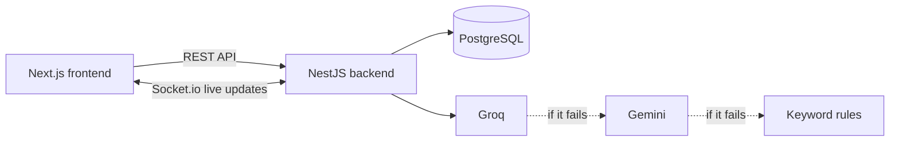

# BookLeaf Author Support & Communication Portal

Authors raise support queries about their books. The BookLeaf team answers them from an admin queue where AI classifies each ticket, sets its priority and drafts a reply.

**Live demo:** https://bookleaf-support-portal-tan.vercel.app (author and admin portals, log in with any account below)
**API docs (Swagger):** https://bookleaf-support-portal-9z4x.onrender.com/api/docs

## Test logins

| Role | Email | Password |
|---|---|---|
| Admin | `admin@bookleaf.com` | `Admin@123` |
| Admin | `support@bookleaf.com` | `Admin@123` |
| Author | `sneha.kulkarni@email.com` | `Author@123` |
| Author | any other author email from the sample data | `Author@123` |

## Tech stack

| | Technology | Version |
|---|---|---|
| Frontend | Next.js · React · TypeScript · Tailwind CSS | 16.4.3 · 19.3.0 · 5.9.3 · 4.3.3 |
| Backend | NestJS · Prisma | 11.2.8 · 6.19.3 |
| Database | PostgreSQL (Neon) | 18 |
| Real-time | Socket.io | 4.8 |
| AI | Groq `qwen/qwen3.8-27b`, Gemini `gemini-3.5-flash-lite` (fallback) | — |
| Runtime | Node.js | 20+ |

## Run locally

**1. Environment files**
The `.env` files are shared separately. Place them here:
- `backend/.env`
- `frontend/.env.local`

**2. Backend** (runs on `http://localhost:5000`)
```bash
cd backend
npm install
npm run db:generate
npm run db:deploy
npm run db:seed
npm run start:dev
```

**3. Frontend** (runs on `http://localhost:3000`, in a second terminal)
```bash
cd frontend
npm install
npm run dev
```

Open `http://localhost:3000` and log in with any account above.

## Architecture



- **Monorepo:** `backend/` (NestJS) and `frontend/` (Next.js).
- **Auth:** JWT login with roles. Authors only ever see their own data; admin routes need the admin role.
- **Real-time:** Socket.io rooms. Each author gets updates only for their own tickets; admins get all ticket updates.
- **AI runs in the background**, so a ticket is saved instantly even if the AI is slow or down.
- **Frontend state:** React hooks and one Context. No extra state library.

## AI integration

**Prompt strategy**
- Classification returns JSON with one of the 6 categories and a priority (Critical / High / Medium / Low).
- Draft replies get only the knowledge-base section for the ticket's category, the tone guidelines, and the author's real book data (copies sold, royalty earned / paid / pending). The model is told to use exact numbers and invent nothing.
- The admin always reviews and edits the draft before sending.

**Error handling**
- Groq → Gemini → keyword rules. The ticket is always created and always classified.
- If no draft can be generated, the admin sees a message and writes the reply manually.
- A provider that returns 429 or 5xx is skipped for a while (respects `Retry-After`).
- API rate limits: login 10/min, AI draft 5/min, everything else 120/min.

**Cost management**
- Only the matching part of the knowledge base is sent, not the whole KB.
- Inputs are trimmed and only the last 3 messages are included.
- Classification runs once per ticket; drafts are saved and reused.
- Every AI call is logged with its token count in the `ai_logs` table. A full ticket uses about 1,000 input and 240 output tokens.

**Model choice:** Groq is fast (under 1 s) and cheap; Gemini is a low-cost fallback on separate infrastructure, so one provider's outage does not stop the app.

## API

Full docs with request and response examples are in Swagger at `/api/docs`.

| Method | Endpoint | Who |
|---|---|---|
| POST | `/api/auth/login` | everyone |
| GET | `/api/author/books` | author |
| GET · POST | `/api/author/tickets` | author |
| GET | `/api/author/tickets/:id` | author |
| POST | `/api/author/tickets/:id/replies` | author |
| GET | `/api/admin/tickets` (filters: status, category, priority, date, search) | admin |
| GET · PATCH | `/api/admin/tickets/:id` | admin |
| POST | `/api/admin/tickets/:id/assign-to-me` | admin |
| POST | `/api/admin/tickets/:id/replies` | admin |
| GET · POST | `/api/admin/tickets/:id/notes` | admin |
| POST | `/api/admin/tickets/:id/ai-draft` | admin |

## Known limitations

- Attachments store only the file name (real upload was optional in the brief).
- Rate limits and the AI provider cooldown are kept in memory (fine for a single server).
- The free hosting tier may sleep, so the first request can take up to a minute.
- No sign-up, password reset or email notifications yet.
